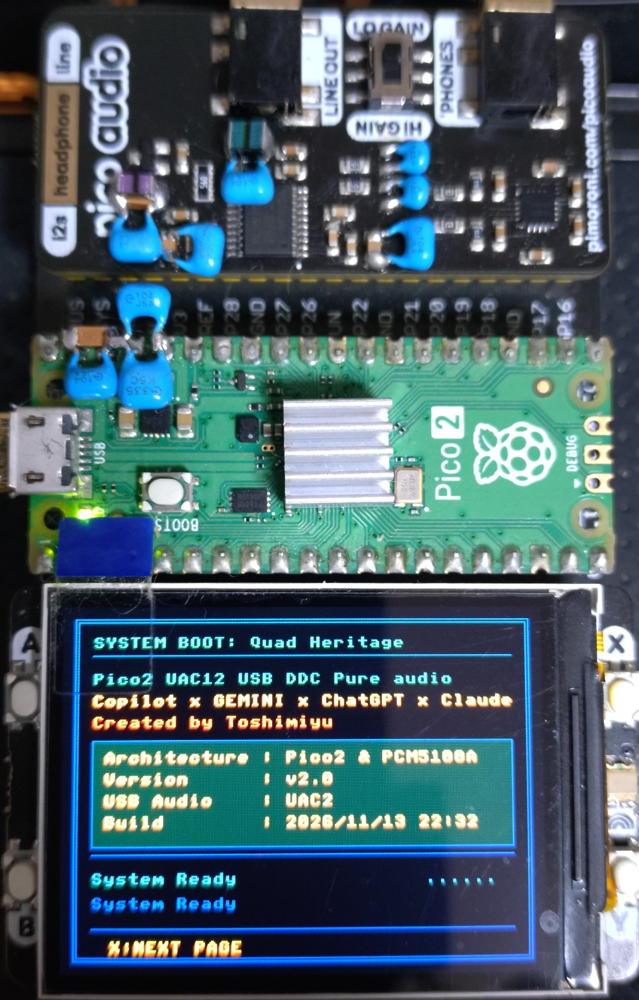
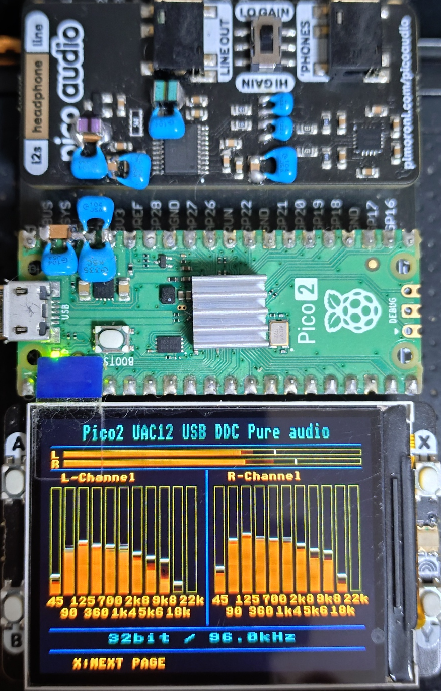

# Pico2_UAC12_USBDDC_Pure_audio（TinyUSB UAC1/UAC2 切替対応）

[English](README_EN.md) | [日本語](README.md)

**現行バージョン: v2.5**

## 概要

本プロジェクトは、従来の `Pico2_UAC12_USBDDC` から診断機能、CDCログ機能を削除した、RP2350（Raspberry Pi Pico 2）用のUSB-DDCファームウェアです。

TinyUSBをベースにUSBオーディオ機能を再構成し、ビルド時にUSB Audio Class 1.0（UAC1）と2.0（UAC2）を選択できます。USBクラス層を分離しながら、共通のオーディオ処理コアを使用します。

### 主な変更点

- UAC1 / UAC2をビルド時に選択可能
- TinyUSBベースのUSBオーディオ層
- Audio State、Ring Buffer、Feedback制御の共通化
- ストリーム再開およびサンプルレート切替処理の改善
- 未使用のGPIOデバッグ機能を削除
- 高クロック動作を修正
- UAC1 / UAC2で共通のオーディオ処理コアを使用

オーディオ処理では、引き続き以下を行いません。

- オーバーサンプリング（NOS）
- FIRフィルター処理
- サンプルレート変換

USB受信データはリングバッファーへ格納する前に、PCMサンプル幅（16/24/32-bit）とステレオフレーム境界を検証します。不正な形式や境界を検出した場合はTinyUSBのOUT FIFOを破棄して再同期します。再生状態機械は有効データが蓄積されるまで待ち、通常の再バッファリング経路で復帰します。

起動時はI²Sクロックとゼロデータを7秒間送信し、その間のUSB音声は破棄します。クロックが途切れた場合は待機時間を延長し、サンプルレート変更は期間終了後に適用します。以後、USB音声データの受信が1秒間なく、残った音声とフェードの出力が終わると、I²Sのデータ・クロックをLowにして停止します。無音のUSB音声データが届き続ける場合は停止しません。受信再開時はクロックとゼロデータを再開し、DACのゼロ検出時間と通常のプリフィルを待って再生します。これはDACのアナログ出力を0 Vに保証するものではありません。アンプの電源投入とは同期しないため、接続前にDAC出力を測定してください。

プリフィル途中でストリームが停止した場合は未再生データを破棄します。ただし、既に出力中のDMAブロックがある場合は最後まで再生し、フェードアウトします。ストリーム再開時は、それ以前の出力がフェードアウトしてから新しい音声を再生します。ストリームを閉じずに行うシークは検出できないため、その境界は補正されません。

USBサスペンド時は未再生のリングデータを破棄し、レジューム後はホストの代替設定を維持して再プリフィルします。バスリセット後はホストが改めてストリームを開く必要があります。

サンプルレート変更時の150 msの強制ドレイン期限は、クロック準備が完了してから計測します。サスペンド中やクロック準備待ちの時間は含めません。

11バンドFFTアナライザーとリアルタイムレベルメーターの表示機能を維持・改善しています。

**ビルド確認済み環境**

- Raspberry Pi Pico SDK v2.3.1
- Toolchain 15_2_Rel1

## 設計目標

- オーディオ信号経路を簡素化する
- 不要なソフトウェアDSP処理をなくす
- オーバーサンプリング、FIRフィルター、サンプルレート変換を行わない信号経路にする
- USB Audio Classごとのコードを分離し、保守性を高める
- UAC1 / UAC2で共通のオーディオエンジンを使う

PCM5100Aは内部でオーバーサンプリングとデジタルフィルター処理を行うため、本ファームウェアではソフトウェアのオーバーサンプリングとFIRフィルターを使用しません。

オーバーサンプリング、FIRフィルター、サンプルレート変換は行いませんが、出力には固定ゲイン比0.80を適用し、さらにUAC1/UAC2の音量設定（0～-64dB）およびミュートをソフトウェアで反映するため、PCMサンプルの値は変化します。

USBミュート／解除は入力PCMに約5msのリニアなゲインランプを適用します。音量変更は従来どおり即時反映します。リングやDMAに既に格納された音声は変更しないため、実際の出力への反映はバッファー分遅れます。PCMが不足した場合は最後のサンプルからサンプルレートに応じた約5msでゼロへフェードし、DMAが無音状態から再開する場合も約5msでフェードインします。ホストがゼロPCMを送り続ける場合は、2ms以上の無音後に約5msでフェードインします。

## 変更履歴

### V2.5

- 起動時のI²Sゼロデータ出力期間を10秒から7秒に短縮
- PCM不足時のフェードアウトをサンプルレートに応じた約5msに変更し、2ms以上のゼロPCM後にも約5msでフェードイン
- USBサスペンド／レジューム時の代替設定と再プリフィル処理、およびバスリセット時の状態初期化を改善
- サンプルレート変更時の強制ドレイン期限をクロック準備後から計測
- v2.5の実機でのポップノイズやDACアナログ出力波形は別途確認が必要

### V2.4

- 起動時は10秒間I²Sのゼロデータを出力し、その間のUSB音声を破棄
- USB音声データを1秒間受信せず、残音とゼロ検出時間の出力が完了するとI²Sを停止。無音データの受信中は継続
- 受信再開時はI²Sのゼロ出力とDACゼロ検出時間を経て、通常のプリフィル後に再生
- PCM不足時やストリーム停止時のフェード、プリフィル途中の未再生データ破棄、旧出力が終了するまでの再生開始待ちを追加
- USB受信FIFOの容量を16パケット相当から24パケット相当へ拡張し、逼迫時の保持量を調整
- 下記のテスト環境では改良前に比べてポップノイズが大幅に減少。停止・再開時のDACアナログ出力波形は別途測定が必要

### V2.3

- 44.1kHzおよび88.2kHz再生時は330MHz、176.4kHz再生時は307.2MHzの専用システムクロックへ切り替え、PIO分周量子化による平均サンプルレート誤差を低減
- USB入力ビット深度にかかわらず、レートごとのI²S出力クロックを統一
- レート切替時にクロック変更前へPIOを停止し、DMA AHBエラー検出時は通常完了として扱わずDMAを停止・復旧
- オーディオリングの確保失敗時に起動を停止し、リング共有状態の読み取りとクリアをスピンロックで同期
- UAC1フィードバックエンドポイントのbRefreshと、反転I²S PIOプログラムの設定を修正
- ジッターの実機測定、DMA AHBエラー復旧およびレート切替の実機検証は未実施

### V2.2

- フィードバック目標をリング容量の50%（2048フレーム）へ変更
- 水位フィードバックの初期化、条件付き積分、レート比例ゲイン、ストリーム間クロック差推定値の引き継ぎを有効化
- UAC1/UAC2のOutput Terminalを`0x0602`（Digital Audio Interface）から`0x0301`（Speaker）へ変更
- UAC1のbcdDeviceを`0x0303`、UAC2のbcdDeviceを`0x0313`へ更新
- UAC1のAndroid標準ドライバー認識、Onkyo HF Playerの独自ドライバー、および標準ドライバーでの再生を確認

### V2.1

- UAC1のbcdDeviceを`0x0303`、UAC2のbcdDeviceを`0x0313`へ更新
- UAC1の音量`SET_RES`要求へ対応

### V2.0

- ファームウェアバージョンをv2.0に更新
- 診断画面、GPIOデバッグ機能、USB CDC診断ログを削除し、USBオーディオ再生に必要な機能へ整理
- UAC1 / UAC2で共通のオーディオ処理と再生画面を維持
- オーディオリングを4096ステレオフレームへ拡張
- フィードバック補正の基本上限を100ppm、低水位時の最大上限を1000ppmへ変更し、バッファリング中は公称レートの500ppmを加算
- サンプルレート切替時の排出待ちタイムアウトを150msへ変更
- システムクロックが同じ場合は電圧およびPLL再設定を省略し、I²S分周比のみ更新
- UAC1/UAC2の構成記述子の最大消費電流を150mAへ設定
- DMA転送を完了IRQ駆動へ変更し、PCM不足時は64フレームの無音を補完
- フィードバック基準を公称レートからPIO分周値による実出力レートへ変更
- USB受信FIFOが75%を超える場合、全体を破棄せず古いフレームを削除して約50%まで下げる

## 特長

- USB Audio Class 1.0 / 2.0 切替対応
- Async Feedback Endpointによる非同期フィードバック制御
- 2048フレーム以上のプリフィル後にI²S再生とPIフィードバック制御を開始
- A特性補正付き11バンドFFT表示
- オーバーサンプリングなし（NOS）
- FIRフィルターなし
- オーバーサンプリング、FIRフィルター、サンプルレート変換を行わないI²S出力
- DMA + PIOによる低遅延I²S転送
- フィードバックの基準レートをPIOの実際の分周値から算出
- RP2350デュアルコア対応
- PICO_AUDIO_PACK対応
- Pico Display Pack 2.0対応

再生中にPCMが不足した場合、DMAは無音を補完し、データ到着後に再生を続けます。FIFO逼迫時はフレーム単位で古いデータの一部を破棄します。DMAは完了割り込みで次のブロックを開始するため、割り込みが長く遅れるとI²Sクロックが途切れることがあります。レート切替中やエラー復旧中のクロック継続は保証しません。

## ハードウェア写真

### システム全体

> **組み立て時の重要注意（向き・配置）**
>
> Treedixドーターボードに各モジュールを取り付ける際は、接続の向きと、DACボード（Pico Audio Pack）およびPico Display Pack 2.0の並び順を必ず下のシステム全体写真で確認してください。向きや並び順を逆にすると、オーディオジャックなどの部品が物理的に干渉し、正しく取り付けられない場合があります。配線・半田付けを始める前に、写真と照らし合わせて配置を確認してください。

#### 起動画面



#### 再生画面



Pico 2 + Pico Audio Pack（PCM5100A）+ Pico Display Pack 2.0

## 表示仕様（Pico Display Pack 2.0）

起動時に起動画面を表示し、初期化完了後は再生画面に切り替わります。Xボタンで起動画面と再生画面を切り替えます。診断画面や診断用USB CDCインターフェースはありません。

### 再生画面

- L/Rレベルメーターで左右の音声レベルを表示します。
- 左右独立の11バンドFFTを表示します。
- 現在のビット深度とサンプルレートを表示します。

ピーク表示は入力信号に合わせて連続的に更新されるため、ちらついて見えることがあります。これは正常な動作です。FFTバーやメーターが動かない場合は、ホスト側の音量やミュート設定を確認してください。

## 対応OS

- Windows 11（26H2で動作確認済み。Foobar2000でWASAPIモードで再生するときは、音源のサンプリングレートとWindows11のサンプリングレートを合わせてから再生を行ってください。ASIO4ALLやASIOドライバー等の場合は、サンプリングレートが異なっていても正常に再生されます。ASIO4ALL2.22で確認済み。）
- Android 16（Sony XQ-ES44スマートフォン。有償版Onkyo HF Player v2.15.2とFoobar2000 Android版 v2.26.1をOS標準オーディオドライバーで動作確認済み）

Onkyo HF Playerは仕様上UAC1モードのみ対応しています。本プロジェクトでは、UAC1モードで上記Android端末との動作を確認しています。

Onkyo HF Playerの独自ドライバーを使用した直後にAndroid標準ドライバーへ切り替える場合は、Androidに正しく認識させるため、USBコネクターを一度抜き差しして再接続してください。

※ Android 16（Sony XQ-ES44）接続時のUSBテスター実測値は、4.972 V・0.140 A（約0.696 W）です。

### v2.4のテスト結果

- UAC1：Windows 11、Android標準ドライバー、Onkyo HF Playerの独自ドライバーで確認
- UAC2：Windows 11、Android標準ドライバーで確認

上記のテスト環境では、改良前に比べてポップノイズが大幅に減少しました。ただし、ごくまれに発生する可能性があり、完全になくなったとは言えません。ランダムノイズの原因は特定できていません。

### Androidでのプツ音の検証

本プロジェクトでも同様のプツ音が発生したため、フィードバック制限値を`FB_BASE_LIMIT_PPM=50`、`FB_BOOST_MAX_PPM=500`に変更しました。以下は派生版の[Pico2_UAC12_USBDDC_Weather](https://github.com/Toshimiyu/Pico2_UAC12_USBDDC_Weather)での検証結果であり、本プロジェクトでの測定値ではありません。

2026年11月13日、Sony XQ-ES44（Android 16、標準オーディオドライバー）をUAC2で使用し、48kHz / 32bitで再生した際の観察結果です。Windows 11 26H2でも48kHz / 32bitで比較しました。

- AndroidのYouTubeとMusicアプリでは、不定期に短いプツ音が発生しました。水位が約50%で安定した後にも発生し、Androidの音量を変更してもプツ音の大きさは変わりませんでした。
- Androidで無音WAVを再生した際には、プツ音は確認されませんでした。無音再生時のUSB形式は未確認です。
- `FB_BASE_LIMIT_PPM=50`、`FB_BOOST_MAX_PPM=500`の試験設定では、Windowsで水位が約3分40秒後に49.9%となり、音切れは確認されませんでした。Android版Foobar2000では水位が約2分27秒後に50%となり、プツ音は確認されませんでした。同設定のMusicアプリではプツ音が残りました。
- MusicアプリでDSEE UltimateをOFFにすると、プツ音の頻度はかなり下がりましたが、不定期のプツ音と一瞬音が濁るような現象は残りました。

フィードバック制限値を小さくすると改善する傾向がありましたが、原因は未特定です。アプリや音響効果、フィードバック制御との関係を引き続き確認する必要があります。上記設定での長時間の安定性は未確認です。補正幅を小さくしすぎると水位が漂い、音切れする可能性があります。

本プロジェクトのv2.0では、Sony XQ-ES44（Android 16）のUAC1モードで、Onkyo HF Playerの独自ドライバーを使用した24bit / 44.1kHzおよび88.2kHzの再生時にプツ音は確認されませんでした。一方、Android標準ドライバーを使用したMusicアプリ（DSEE Ultimate OFF）とFoobar2000の24bit / 48kHz再生ではプツ音が発生しました。再生形式が異なるため、原因は特定できていません。

## USB Audio Classの選択

次のCMake設定で、ビルド時にUAC1 / UAC2を選択します。

```cmake
USB_AUDIO_CLASS_VERSION
```

| 値 | モード |
|----|--------|
| 1 | UAC1 |
| 2 | UAC2 |
| 未指定 | UAC2 |

フィードバック値は共通の16.16形式でTinyUSBに渡します。付属のTinyUSBが、Full-SpeedのUAC1では3バイトの10.14形式に変換し、UAC2ではWindows互換の4バイト16.16形式で送信します。外部のTinyUSBを指定する場合も、この変換と送信サイズに対応したバージョンが必要です。

フィードバック形式の回帰テストは、ネイティブGCCとGNUリンカーがある環境で、リポジトリのルートから次のように実行できます（Windows PowerShellの例）。

```powershell
gcc -std=c11 -O2 -ffunction-sections -fdata-sections -I tests\feedback -I tinyusb\src tests\feedback\feedback_test.c '-Wl,--gc-sections' -o "$env:TEMP\feedback_test.exe"
& "$env:TEMP\feedback_test.exe"
```

ビルド環境がない方は、リリースノートからUAC1・UAC2それぞれのファームウェアをダウンロードして書き込み、ご使用ください。

### ビルドコマンド（2026-11-01確認）

リポジトリのルートディレクトリで実行してください。

※ビルド時は、事前に既存の`build`フォルダーを削除してCMakeキャッシュをクリアしてください。

#### UAC1ビルド

```powershell
cd <repository_directory>\Pico2_UAC12_USBDDC

cmake -S . -B build -DUSB_AUDIO_CLASS_VERSION=1

cmake --build build
```

#### UAC2ビルド

```powershell
cd <repository_directory>\Pico2_UAC12_USBDDC

cmake -S . -B build -DUSB_AUDIO_CLASS_VERSION=2

cmake --build build
```

### Windows PowerShellでのビルド

PowerShellで次のエラーが表示された場合：

```text
'cmake' is not recognized as an internal or external command
```

CMakeが利用可能か確認します。

```powershell
where.exe cmake
```

結果が表示されない場合は、CMakeをインストールしてください。

```powershell
winget install Kitware.CMake
```

インストール後、PowerShellを再起動します。CMakeがインストール済みでも見つからない場合は、インストール先をPATHに追加してください。

```powershell
$env:Path += ";C:\Program Files\CMake\bin"
```

恒久的に設定するには、Windowsのユーザー環境変数PATHにCMakeのインストール先を追加します。

インストールを確認します。

```powershell
cmake --version
```

バージョンが表示されたら、構成とビルドを実行します。

```powershell
cd C:\path\to\Pico2_UAC12_USBDDC

cmake -S . -B build -DUSB_AUDIO_CLASS_VERSION=1

cmake --build build
```

UAC2をビルドする場合は、`USB_AUDIO_CLASS_VERSION=1` を `USB_AUDIO_CLASS_VERSION=2` に変更してください。

SDK、コンパイラー、Ninjaに関するエラーが発生した場合は、Visual Studio CodeにRaspberry Pi Pico拡張機能をインストールし、次の環境を使用してください。

- Pico SDK v2.3.1
- Toolchain 15_2_Rel1

### 生成されるファームウェア

ビルドが成功すると、次のUF2ファイルが生成されます。

#### UAC1

```text
build/src/Pico2_UAC12_USBDDC_Pure_audio_UAC1.uf2
```

#### UAC2

```text
build/src/Pico2_UAC12_USBDDC_Pure_audio_UAC2.uf2
```

書き込み手順：

1. BOOTSELボタンを押したままにします。
2. Pico 2をPCに接続します。
3. RP2350ドライブが表示されます。
4. 生成されたUF2ファイルをドライブにコピーします。

### モード仕様

#### UAC1（`USB_AUDIO_CLASS_VERSION=1`）

- USB Audio Class 1.0
- PCM 16bit / 24bit
- 44.1kHz / 48kHz / 88.2kHz / 96kHz

#### UAC2（`USB_AUDIO_CLASS_VERSION=2`）

- USB Audio Class 2.0
- PCM 16bit / 24bit / 32bit
- サンプルレート上限はFull-Speed USBの帯域幅によって異なります

UAC固有のディスクリプターと制御ハンドラーは、選択したモードに応じて切り替わります。以下のモジュールは共通です。

- オーディオエンジン
- リングバッファー
- Async Feedback
- FFT処理
- 表示システム
- I²S出力

## 対応DAC

- Pico Audio Pack（PCM5100A）

Pico Audio Pack（PCM5100A）で動作を確認しています。

※PCM5102A搭載のDACボードも所有していますが、本プロジェクトのコンセプト外のため、現時点では動作確認を行っていません。お問い合わせがあれば確認します。

## USB入力仕様

- USB Audio Class 1.0 または 2.0
- Async Feedback Endpoint
- ステレオPCM

### UAC1

| ビット深度 | サンプルレート |
|------------|----------------|
| 16bit | 44.1 / 48 / 88.2 / 96kHz |
| 24bit | 44.1 / 48 / 88.2 / 96kHz |

### UAC2

| ビット深度 | サンプルレート |
|------------|----------------|
| 16bit | 44.1 / 48 / 88.2 / 96 / 176.4 / 192kHz |
| 24bit | 44.1 / 48 / 88.2 / 96kHz |
| 32bit | 44.1 / 48 / 88.2 / 96kHz |

### 注意事項

※RP2350 USB Device ControllerはFull-Speed USBのみをサポートします。

Full-Speed USBでの現在の上限：

| フォーマット | 最大レート |
|--------------|------------|
| UAC2 16bit | 192kHz |
| UAC2 24bit | 96kHz |
| UAC2 32bit | 96kHz |

※24bit / 32bitの176.4kHzおよび192kHzはFull-Speed USBのパケットサイズ上限を超えるため、サポートしていません。

※Onkyo HF PlayerはUAC1モードで動作確認しています。

## I²S出力仕様

- I²S
- ステレオ
- 32bit PCM形式
- 入力サンプルレート追従
- サンプルレート変換なし
- オーバーサンプリングなし
- オーバーサンプリング、FIRフィルター、サンプルレート変換を行わないI²S出力

### 注意事項

※ファームウェアは固定ゲイン比0.80に加え、ホストから受け取るUAC1/UAC2の音量設定（0～-64dB）とミュートをソフトウェアゲインに反映します。ホスト側の音量設定によって出力レベルが変わります。

## 再生に関する注意

- ※Windowsのオーディオ設定によって音切れが発生する場合があります
- ※安定性は再生ソフト、ホスト性能、システム負荷に左右されます
- ※サンプルレートの組み合わせによって、安定性が異なる場合があります

音切れが発生する場合は、次の方法を試してください。

- ASIOとWASAPIを切り替える
- 再生サンプルレートを下げる
- Windowsの出力サンプルレート設定を下げる

## FFTスペクトル表示

### リアルタイム11バンドFFTアナライザー

表示デバイス：Pico Display Pack 2.0

周波数帯：

- 45Hz
- 90Hz
- 125Hz
- 360Hz
- 700Hz
- 1.4kHz
- 2.8kHz
- 5.6kHz
- 9.8kHz
- 18kHz
- 22kHz

### FFT設定

- `FFT_LEN = 2048`
- 窓関数：ハン窓
- 重み付け：A特性
- Ring Buffer水位監視
- Feedback制御の可視化

RP2350の処理性能と低い表示遅延に合わせ、リアルタイムのFFTスペクトルとバッファー状態を表示します。

## アーキテクチャ

### ハードウェア

- Raspberry Pi Pico 2（RP2350）

### 開発環境

**ビルド確認済み**

- Raspberry Pi Pico SDK v2.3.1
- Toolchain 15_2_Rel1
- Visual Studio Code

### 表示・解析用ハードウェア

- Pico Display Pack 2.0
- ドーターボードを介して接続

### データ経路

- TinyUSB UAC1 / UAC2クラス層
- 共通オーディオ処理コア
- DMA + PIOによる低遅延I²S出力

### マルチコア処理

#### Core0

- LCD描画
  - FFT表示
  - バッファー水位表示
- メインループで無信号状態を監視し、500ms経過後にバッファーを後処理
- クロック切替制御
  - 44.1kHz系：336MHz
  - 48kHz系：360MHz
- ソフトウェア音声ミュート（出力ゲイン制御）

#### Core1

- I²S出力処理
- DMA転送処理
- FFT処理
  - ハン窓
  - A特性計算

### USB制御

- TinyUSB UAC1 / UAC2切替層
- 共通Async Feedbackクロック同期制御

### タイミング制御

- Core0メインループでの経過時間監視

### RAM上での実行

起動時にファームウェアをRAMへコピーし、RAM上で実行します。

Flashクロック分周設定：

```text
Divider = 3
```

動作中に確認された値：

| サンプルレート系統 | Flashクロック |
|--------------------|---------------|
| 44.1 / 88.2 / 176.4kHz | 112MHz |
| 48 / 96 / 192kHz | 120MHz |

## ピン配置

### I²Sインターフェース

| 機能 | GPIO |
|------|------|
| I²S DATA | GP9 |
| I²S BCLK | GP10 |
| I²S LRCK | GP11 |

### Pico Display Pack 2.0

| 機能 | GPIO |
|------|------|
| SPI / 制御インターフェース | GP16 - GP20 |

### 画面操作ボタン

| ボタン | GPIO | 用途 |
|--------|------|------|
| X | GP14 | 次の画面 |
内部プルアップを有効にしています。

### RGB LED

GPIOリソースの競合を避けるため、Pico Display PackのRGB LED（GP6～GP8）は消灯状態にしています。現行ファームウェアではI²C出力およびGP5のDAC ENABLE信号は使用しません。

## ビルドと使用方法

※ビルド時は、事前に既存の`build`フォルダーを削除してキャッシュをクリアしてください。

1. ドーターボードを介して各ハードウェアを接続します。
2. Visual Studio CodeにRaspberry Pi Pico拡張機能をインストールします。
3. このリポジトリをクローンします。
4. Visual Studio Codeでプロジェクトをビルドします。
5. Pico 2のBOOTSELボタンを押したままPCに接続します。
6. RP2350のマスストレージデバイスが表示されます。
7. 生成されたUF2ファイルをデバイスにコピーします。
8. 再起動後、選択したUSB Audio Classデバイス（UAC1またはUAC2）として認識されます。

推奨環境：

- Pico SDK v2.3.1
- Toolchain 15_2_Rel1

## 開発の背景

オーディオ処理経路を簡素化し、不要なソフトウェア処理を減らすために、プロジェクトを再設計しました。

- ソフトウェアのオーバーサンプリングを削除
- ソフトウェアのFIRフィルターを削除
- 信号経路と処理経路を簡素化
- LUFAからTinyUSBへ移行
- UAC1 / UAC2共通アーキテクチャを採用
- FFT表示とクリッピング保護を維持

※PCM5100Aには、オーバーサンプリングとデジタルフィルター処理が内蔵されています。そのため、本プロジェクトではソフトウェアのオーバーサンプリング、FIRフィルター、サンプルレート変換を行いません。ただし、音量・ミュートのためのソフトウェアゲイン制御を行います。

処理性能向上のため、RP2350はオーバークロック設定で動作します。評価時の確認用システムにはヒートシンクを取り付けています。

### テスト環境

#### ハードウェア

- Raspberry Pi Pico 2（RP2350）
- Pico Audio Pack（PCM5100A）
- Pico Display Pack 2.0
- Sony XQ-ES44スマートフォン

#### ソフトウェア

**Windows**

- Windows 11 26H2
- Foobar2000 v2.26.1 (x64)
- ASIO4ALL 2.22

**Android**

- Android 16
- Onkyo HF Player v2.15.2 UAC1版
- Foobar2000 Android版 v2.26.1（ARM、OS標準オーディオドライバー） UAC1/2両版　

## ライセンス

MIT License

Copyright (c) 2026 Toshimiyu

## 参考資料

- USB Audio Class 1.0 Specification
- USB Audio Class 2.0 Specification
- TinyUSB Project
- Raspberry Pi Pico SDK v2.3.1
- RP2350 Documentation
- PCM5100A Datasheet
- 参考にさせていただいたArqAlice様（Pico2UltraHiResUSBDDC）に感謝申し上げます
