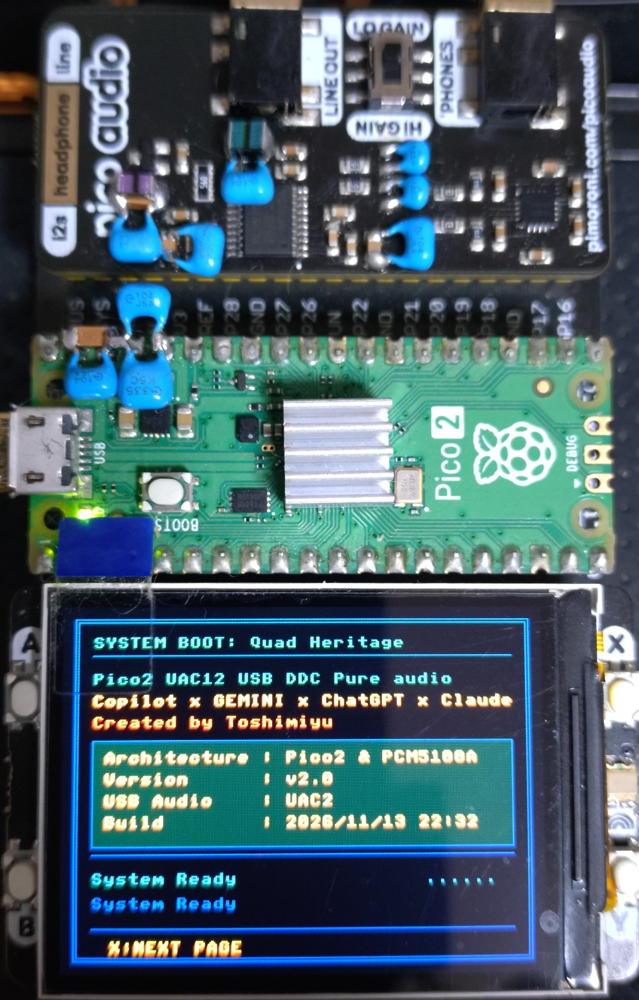
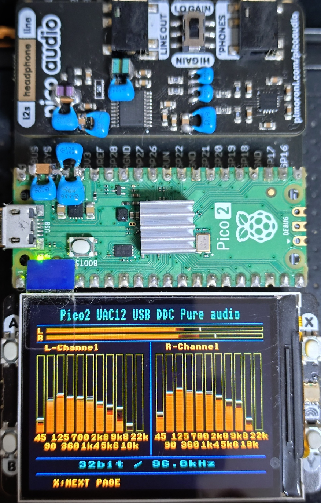

# Pico2_UAC12_USBDDC_Pure_audio (TinyUSB UAC1/UAC2 Selectable)

[English](README_EN.md) | [日本語](README.md)

**Current version: v2.0**

## Description

This is USB DDC firmware for the RP2350 (Raspberry Pi Pico 2), based on `Pico2_UAC12_USBDDC` with its diagnostic features and CDC logging removed.

The USB audio subsystem has been redesigned around TinyUSB, allowing USB Audio Class 1.0 and 2.0 selection at build time while sharing a common audio-processing core.

### What's New

- UAC1 / UAC2 selectable build configuration
- TinyUSB-based USB audio layer
- Common Audio State / RingBuffer / Feedback architecture
- Enhanced stream restart and sample-rate switching handling
- Removal of unused GPIO debug functions
- Fixed high-clock operation
- Shared audio-processing core across UAC1 and UAC2
- Removed the diagnostic screen and USB CDC diagnostic logging

Audio processing remains:

- No Oversampling (NOS)
- No FIR Filtering
- No Sample Rate Conversion

Before USB audio data is written to the ring buffer, its PCM sample width (16/24/32-bit) and stereo frame boundaries are checked. If an invalid format or boundary is detected, the TinyUSB OUT FIFO is cleared to resynchronize. The playback state machine waits for valid data and resumes through the normal rebuffering sequence.

Display features such as the 11-band FFT analyzer and real-time level meters have been retained and improved.

**Build Verified**

- Raspberry Pi Pico SDK v2.3.1
- Toolchain 15_2_Rel1

---

## Design Goals

This project was developed with the following goals:

- Simplify the audio signal path
- Remove unnecessary software DSP processing
- Avoid oversampling, FIR filtering, and sample-rate conversion in the signal path
- Improve maintainability by separating USB Audio Class specific code
- Share a common audio engine across UAC1 and UAC2

Software oversampling and FIR filtering were removed because the PCM5100A already implements internal oversampling and digital filtering.

The firmware does not perform oversampling, FIR filtering, or sample-rate conversion, but it always applies a fixed output gain ratio of 0.80 and also applies UAC1/UAC2 host volume settings (0 to -64 dB) and mute in software, changing the PCM sample values.

USB mute and unmute apply an approximately 5 ms linear gain ramp to incoming PCM. Volume changes still take effect immediately. Audio already queued in the ring and DMA is not changed, so the audible response is delayed by the queued audio. Input faults and underruns do not trigger automatic mute or fading.

---

## Change History

### V2.0

- Updated the firmware version to v2.0
- Removed the diagnostic screen, GPIO debug functions, and USB CDC diagnostic logging, keeping the features needed for USB audio playback
- Retained the shared UAC1/UAC2 audio core and playback display

---

## Features

- Selectable USB Audio Class 1.0 / 2.0
- Asynchronous feedback control using an Async Feedback Endpoint
- Starts I²S playback and PI feedback control after a sample-rate-dependent prefill of approximately 6 ms
- 11-band FFT display with A-weighting
- No oversampling (NOS)
- No FIR filtering
- I²S output without oversampling, FIR filtering, or sample-rate conversion
- Low-latency I²S transfer using DMA + PIO
- RP2350 dual-core support
- PICO_AUDIO_PACK support
- Pico Display Pack 2.0 support

---

## Hardware Photo

### Complete System

> **Important assembly note (orientation and placement)**
>
> When mounting the modules on the Treedix daughterboard, carefully check their orientation and the order of the DAC board (Pico Audio Pack) and Pico Display Pack 2.0 against the complete-system photos below. Reversing the orientation or order may cause physical interference with components such as the audio jack, preventing proper installation. Confirm the placement against the photos before wiring or soldering.

#### Boot Screen



#### Playback Screen



Pico2 + Pico Audio Pack (PCM5100A) + Pico Display Pack 2.0

---

## Display Specification (Pico Display Pack 2.0)

The boot screen appears at startup, then changes to the playback screen after initialization. The X button switches between the boot and playback screens. There is no diagnostics screen or diagnostic USB CDC interface.

### Playback Screen

- L/R level meters display the left and right audio levels.
- An independent 11-band FFT is displayed for each channel.
- The current bit depth and sample rate are shown.

The peak indicators update continuously with the input signal and may appear to flicker; this is normal. If the FFT bars and meters do not move, check the host volume and mute settings.

## Supported Operating Systems

- Windows 11 (verified on Windows 11 26H2. When playing in WASAPI mode with Foobar2000, match the source sample rate to the Windows 11 sample rate before playback. With ASIO4ALL or other ASIO drivers, playback works normally even if the sample rates differ. Verified with ASIO4ALL 2.22.)
- Android 16 (verified on a Sony XQ-ES44 smartphone with the paid version of Onkyo HF Player v2.15.2 and Foobar2000 for Android using the OS standard audio driver)

Onkyo HF Player supports UAC1 mode only. This project has been verified with HF Player in UAC1 mode on the Android device listed above.

When using the Android standard driver instead of Onkyo HF Player's proprietary driver (e.g. with Foobar2000), operation has been verified in both UAC1 and UAC2 modes on the Sony XQ-ES44, but clicks may occur. After using Onkyo HF Player's proprietary driver, disconnect and reconnect the USB connector once before switching to the Android standard driver so that Android can recognize the device correctly.

Note: With the Android 16 (Sony XQ-ES44) device connected, a USB tester measured 4.972 V and 0.140 A (approximately 0.696 W).

### Android Click Investigation

Similar clicks occurred in this project, so the feedback limits were changed to `FB_BASE_LIMIT_PPM=50` and `FB_BOOST_MAX_PPM=500`. The results below are from the derived [Pico2_UAC12_USBDDC_Weather](https://github.com/Toshimiyu/Pico2_UAC12_USBDDC_Weather) project, not measurements of this project.

On November 13, 2026, playback was observed on a Sony XQ-ES44 running Android 16 with the standard audio driver, using UAC2 at 48 kHz / 32-bit. Windows 11 26H2 was also tested at 48 kHz / 32-bit.

- YouTube and the Music app on Android produced intermittent short clicks, including after the ring level settled around 50%. Changing the Android volume did not change the click volume.
- No clicks were observed while playing a silent WAV on Android. The USB format during silent playback was not confirmed.
- With the test settings `FB_BASE_LIMIT_PPM=50` and `FB_BOOST_MAX_PPM=500`, the Windows ring level reached 49.9% after about 3 minutes 40 seconds without observed dropouts. Android Foobar2000 reached 50% after about 2 minutes 27 seconds without observed clicks. Clicks remained with the Music app under the same settings.
- Turning DSEE Ultimate off in the Music app greatly reduced click frequency, but intermittent clicks and brief muddy-sounding audio remained.

Reducing the feedback limits tended to improve the symptoms, but the cause remains unconfirmed. The roles of the app, audio effects, and feedback control need further investigation. Long-term stability with these settings has not been verified; overly narrow correction limits can allow the ring level to drift and cause dropouts.

With v2.0 of this project on a Sony XQ-ES44 (Android 16) in UAC1 mode, no clicks were observed using Onkyo HF Player's proprietary driver at 24-bit / 44.1 kHz or 88.2 kHz. In contrast, clicks occurred at 24-bit / 48 kHz with the Android standard driver in the Music app (DSEE Ultimate off) and Foobar2000. The cause remains unknown because the playback formats differed.

---

## USB Audio Class Selection

UAC1 and UAC2 can be selected at build time using:

```cmake
USB_AUDIO_CLASS_VERSION
```

| Value | Mode |
|---------|---------|
| 1 | UAC1 |
| 2 | UAC2 |
| Not specified | UAC2 |

If you don't have a build environment, download the UAC1 or UAC2 firmware from the release notes, flash it, and use it.

### Build Commands (Verified: 2026-11-01)

Build from the repository root directory.

Note: Before building, delete the existing `build` folder to clear the CMake cache.

#### UAC1 Build

```powershell
cd <repository_directory>\Pico2_UAC12_USBDDC_Pure_audio

cmake -S . -B build -DUSB_AUDIO_CLASS_VERSION=1

cmake --build build
```

#### UAC2 Build

```powershell
cd <repository_directory>\Pico2_UAC12_USBDDC_Pure_audio

cmake -S . -B build -DUSB_AUDIO_CLASS_VERSION=2

cmake --build build
```

### Building from Windows PowerShell

If PowerShell reports:

```text
'cmake' is not recognized as an internal or external command
```

verify whether CMake is available:

```powershell
where.exe cmake
```

If no result is returned, install CMake:

```powershell
winget install Kitware.CMake
```

Restart PowerShell after installation.

If CMake is already installed but not found, add the installation directory to PATH:

```powershell
$env:Path += ";C:\Program Files\CMake\bin"
```

To make the change permanent, add the CMake installation directory to the Windows user PATH environment variable.

Verify installation:

```powershell
cmake --version
```

If a version number is displayed, configure and build the project:

```powershell
cd C:\path\to\Pico2_UAC12_USBDDC_Pure_audio

cmake -S . -B build -DUSB_AUDIO_CLASS_VERSION=1

cmake --build build
```

For UAC2 builds, change:

```text
USB_AUDIO_CLASS_VERSION=1
```

to

```text
USB_AUDIO_CLASS_VERSION=2
```

If SDK, compiler, or Ninja-related errors occur, install the Raspberry Pi Pico extension for Visual Studio Code and use:

- Pico SDK v2.3.1
- Toolchain 15_2_Rel1

---

### Generated Firmware Files

Successful builds generate the following UF2 files:

#### UAC1

```text
build/src/Pico2_UAC12_USBDDC_Pure_audio_UAC1.uf2
```

#### UAC2

```text
build/src/Pico2_UAC12_USBDDC_Pure_audio_UAC2.uf2
```

To program the device:

1. Hold the BOOTSEL button.
2. Connect Pico 2 to the PC.
3. The RP2350 drive appears.
4. Copy the generated UF2 file onto the drive.

---

### Mode Specifications

#### UAC1 (`USB_AUDIO_CLASS_VERSION=1`)

- USB Audio Class 1.0
- PCM 16bit / 24bit
- 44.1kHz
- 48kHz
- 88.2kHz
- 96kHz

#### UAC2 (`USB_AUDIO_CLASS_VERSION=2`)

- USB Audio Class 2.0
- PCM 16bit / 24bit / 32bit
- Sample-rate limits depend on Full-Speed USB bandwidth

UAC-specific descriptors and control handlers are switched according to selected mode.

The following modules are shared:

- Audio Engine
- Ring Buffer
- Async Feedback
- FFT Processing
- Display System
- I²S Output

---

## Supported DAC

- Pico Audio Pack (PCM5100A)

Operation has been verified with the Pico Audio Pack (PCM5100A).

Note: A PCM5102A-based DAC board is available, but has not been tested because it is outside the scope of this project. It can be checked if requested.

---

## USB Input Specifications

- USB Audio Class 1.0 or 2.0
- Async Feedback Endpoint
- Stereo PCM

### UAC1

| Bit Depth | Sample Rate |
|------------|------------|
| 16bit | 44.1 / 48 / 88.2 / 96kHz |
| 24bit | 44.1 / 48 / 88.2 / 96kHz |

### UAC2

| Bit Depth | Sample Rate |
|------------|-------------|
| 16bit | 44.1 / 48 / 88.2 / 96 / 176.4 / 192kHz |
| 24bit | 44.1 / 48 / 88.2 / 96kHz |
| 32bit | 44.1 / 48 / 88.2 / 96kHz |

### Notes

Note: The RP2350 USB Device Controller supports:

```text
Full-Speed USB only
```

Current Full-Speed limitations:

| Format | Maximum Rate |
|----------|----------|
| UAC2 16bit | 192kHz |
| UAC2 24bit | 96kHz |
| UAC2 32bit | 96kHz |

Note: 24bit/32bit 176.4kHz and 192kHz exceed the Full-Speed USB packet-size limit and are therefore not supported.

Note: Onkyo HF Player has been verified in UAC1 mode.

---

## I²S Output Specifications

- I²S
- Stereo
- 32bit PCM Format
- Input Sample Rate Follow Mode
- No Sample Rate Conversion
- No Oversampling
- I²S output without software oversampling, FIR filtering, or sample-rate conversion

### Notes

Note: The firmware applies a fixed output gain ratio of 0.80, and also applies UAC1/UAC2 volume settings (0 to -64 dB) and mute received from the host through software gain. The host volume setting therefore affects the output level.

---

## Playback Notes

- Note: Audio dropouts may occur depending on Windows audio settings
- Note: Stability depends on playback software, host performance, and system load
- Note: Stability may vary depending on the sample-rate combination

If dropouts occur:

- Switch between ASIO and WASAPI
- Reduce playback sample rate
- Reduce Windows output sample rate settings

---

## FFT Spectrum Display

### Real-Time 11-Band FFT Spectrum Analyzer

Display Device:

- Pico Display Pack 2.0

Frequency Bands:

- 45Hz
- 90Hz
- 125Hz
- 360Hz
- 700Hz
- 1.4kHz
- 2.8kHz
- 5.6kHz
- 9.8kHz
- 18kHz
- 22kHz

### FFT Configuration

- FFT_LEN = 2048
- Window Function: Hann Window
- Weighting: A-Weighting
- RingBuffer Water-Level Monitoring
- Feedback-Control Visualization

The display system provides a real-time FFT spectrum visualization and buffer-status indication optimized for RP2350 performance and low display latency.

---

## Architecture

### Hardware

- Raspberry Pi Pico 2 (RP2350)

### Development Environment

**Build Verified**

- Raspberry Pi Pico SDK v2.3.1
- Toolchain 15_2_Rel1
- Visual Studio Code

### Display and Analysis Hardware

- Pico Display Pack 2.0
- Connected through a daughterboard

### Data Path

- TinyUSB UAC1/UAC2 class layer
- Shared audio-processing core
- DMA + PIO low-latency I²S output

### Multi-Core Processing

#### Core0

- LCD rendering
  - FFT visualization
  - Buffer water-level display
- Monitors audio inactivity in the main loop and cleans up the buffer after 500 ms
- Clock switching control
  - 44.1kHz family: 336MHz
  - 48kHz family: 360MHz
- Software audio mute (output gain control)

#### Core1

- I²S output processing
- DMA transfer handling
- FFT processing
  - Hann Window
  - A-Weighting calculation

### USB Control

- TinyUSB UAC1/UAC2 selectable layer
- Shared Async Feedback clock synchronization control

### Timing Control

- Elapsed-time monitoring in the Core0 main loop

### RAM Execution

The firmware is copied to RAM and executed from RAM during startup.

Flash clock divider setting:

```text
Divider = 3
```

Observed values during operation:

| Sample Rate Family | Flash Clock |
|-------------------|------------|
| 44.1 / 88.2 / 176.4kHz | 112MHz |
| 48 / 96 / 192kHz | 120MHz |

---

## Pin Assignment

### I²S Interface

| Function | GPIO |
|----------|------|
| I²S DATA | GP9 |
| I²S BCLK | GP10 |
| I²S LRCK | GP11 |

### Pico Display Pack 2.0

| Function | GPIO |
|----------|------|
| SPI / Control Interface | GP16 - GP20 |

### Navigation Buttons

| Button | GPIO | Usage |
|----------|------|------|
| X | GP14 | Next Screen |

Internal pull-up enabled.

### RGB LED

The Pico Display Pack RGB LED is intentionally kept off; its active-low channels on GP6-GP8 are driven high. The current firmware does not use I²C output or a DAC ENABLE signal on GP5.

---

## Build and Usage

Note: Before building, delete the existing `build` folder to clear the cache.

1. Connect all hardware through the daughterboard.
2. Install the Raspberry Pi Pico Extension for Visual Studio Code.
3. Clone this repository.
4. Build the project in Visual Studio Code.
5. Hold the Pico 2 BOOTSEL button while connecting to the PC.
6. The RP2350 mass-storage device appears.
7. Copy the generated UF2 file to the device.
8. After reboot, the system is recognized as the selected USB Audio Class device (UAC1 or UAC2).

Recommended Environment:

- Pico SDK v2.3.1
- Toolchain 15_2_Rel1

---

## Development Background

The project was redesigned to simplify the audio-processing path and reduce unnecessary software processing.

Changes include:

- Removal of software oversampling
- Removal of software FIR filtering
- Simplification of signal and processing paths
- Migration from LUFA to TinyUSB
- Shared UAC1/UAC2 architecture
- Retained FFT visualization and clipping protection

The PCM5100A already contains internal oversampling and digital-filter processing.

For this reason, the firmware avoids software oversampling, FIR filtering, and sample-rate conversion. However, software gain control is applied for volume and mute.

The RP2350 is operated in an overclocked configuration.

The verified test system was equipped with a heatsink during evaluation.

### Tested Environment

#### Hardware

- Raspberry Pi Pico 2 (RP2350)
- Pico Audio Pack (PCM5100A)
- Pico Display Pack 2.0
- Sony XQ-ES44 smartphone

#### Software

**Windows**

- Windows 11 26H2
- Foobar2000 v2.26.1 (x64)
- ASIO4ALL 2.22

**Android**

- Android 16
- Onkyo HF Player v2.15.2 (UAC1 version)
- Foobar2000 for Android v2.26.1 (ARM, OS standard audio driver; UAC1/UAC2 versions)

---

## License

MIT License

Copyright (c) 2026 Toshimiyu

---

## References

- USB Audio Class 1.0 Specification
- USB Audio Class 2.0 Specification
- TinyUSB Project
- Raspberry Pi Pico SDK v2.3.1
- RP2350 Documentation
- PCM5100A Datasheet
- With gratitude to ArqAlice (Pico2UltraHiResUSBDDC), whose work served as a reference
